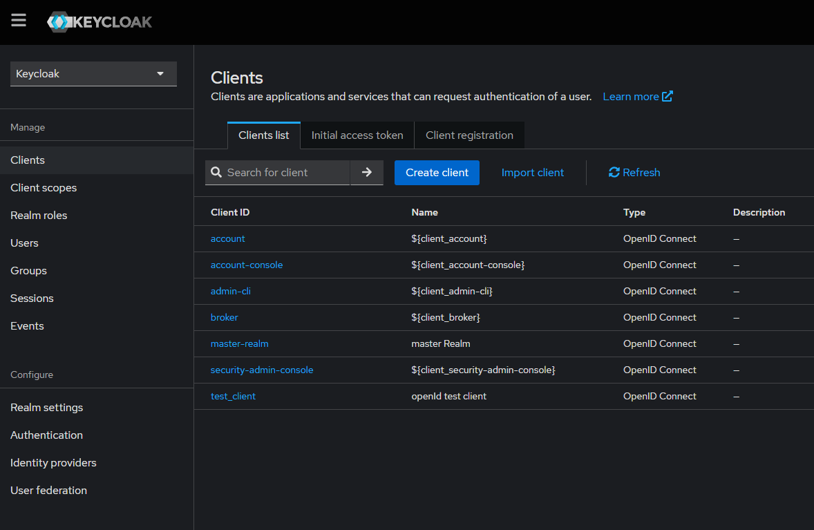
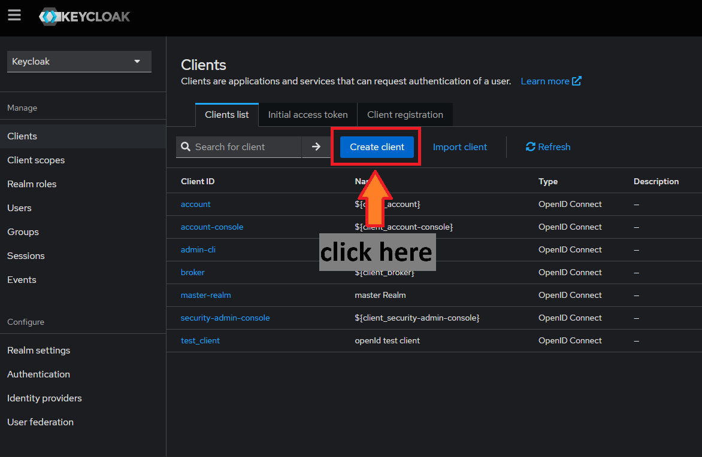
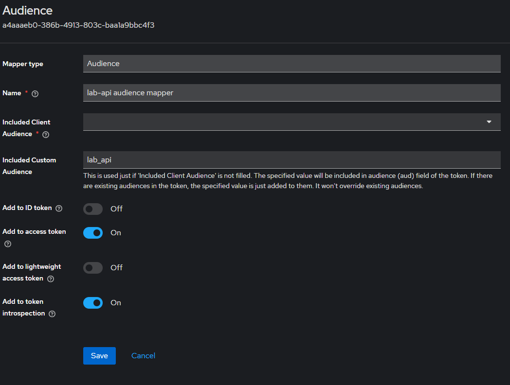
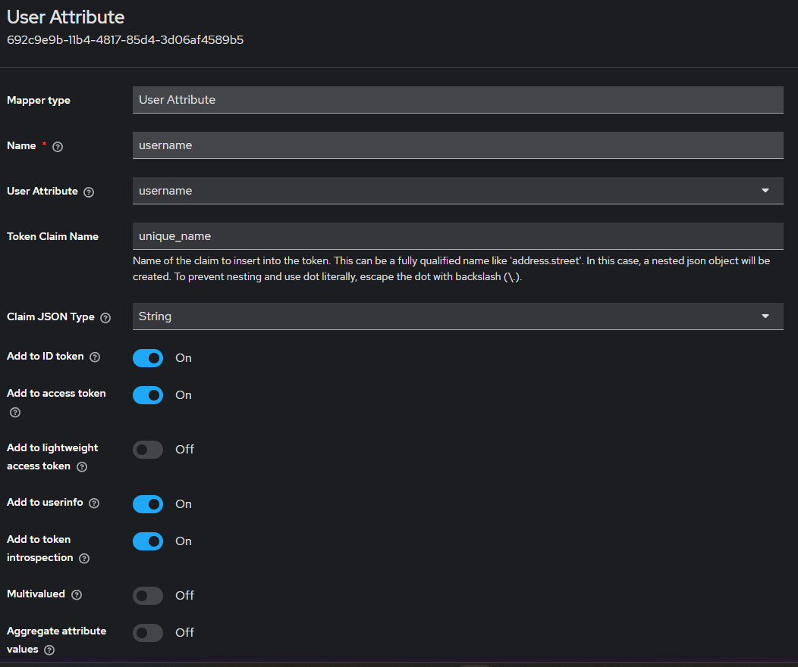

# dotnet Lab

## Authentication Server (keycloak) prepare

- docker run
    ```bash
    docker run -d -p 8080:8080 -p 8443:8443 \
        -e KEYCLOAK_ADMIN=user \
        -e KEYCLOAK_ADMIN_PASSWORD=password \
        quay.io/keycloak/keycloak start-dev
    ```
- import test client
    - client id testing json : [link](./keycloak/test_client.json)
    - open clients page</br>
        
    - click import client</br>
        
- set client scopes mappers
  - audience mapper</br>
    
  - user name</br>
    

### keycloak export

**這邊的 keycloak 都是使用 dev mode 啟動，所以使用的是 H2 資料庫**

**匯出命令最後沒有加上 `--users <mode>` 參數的目的是要使用預設的 `different_files` 方式匯出，其他還有以下模式**
- --users realm_file：把使用者寫進同一個 realm 檔（單一 JSON），所以看起來「合併在一起」。
- --users same_file：realm 一個檔、所有使用者集中在另一個單獨檔（兩個檔）。
- --users different_files（預設）：realm 一個檔、使用者分割成多個檔（*-users-0.json, *-users-1.json…），可用 --users-per-file 控制每檔人數。
- --users skip：不匯出使用者。

**這邊偷懶所有設定都直接在 master，因此是匯出 master，如果真的要實際在自己的服務中使用，建議重新審視設定**

#### 方法 1

- 建立當下容器的快照
```shell
docker commit keycloak kc-snap:export
#             <要快照的容器> <快照後的映象名稱>
```
- 使用快照執行備份指令
```shell
docker run --rm --name kc-export -v ${PWD}\keycloak\backup:/tmp/backup kc-snap:export export --dir /tmp/backup --realm master
```

#### 方法 2

- 要備份的 keycloak 容器需要將 `/opt/keycloak/data` 路徑掛到 volumes 上
- 使用另外一個 keycloak 容器連到同一個 volumes 並執行備份命令
```shell
docker run --rm --name kc-export --volumes-from keycloak -v ./keycloak/backup:/tmp/backup quay.io/keycloak/keycloak:26.3 export --dir /tmp/backup --realm master
```

#### ref

- https://stackoverflow.com/questions/72128765/import-realm-in-keycloak18-x
- https://www.keycloak.org/server/containers

## architecture ref

- https://romanglushach.medium.com/hexagonal-architecture-the-secret-to-scalable-and-maintainable-code-for-modern-software-d345fdb47347
- https://en.wikipedia.org/wiki/Hexagonal_architecture_(software)
- https://medium.com/idealo-tech-blog/hexagonal-ports-adapters-architecture-e3617bcf00a0

## 專案結構與 ArchPrecept

本方案使用已發布的 **ArchPrecept 0.0.2-preview**，透過 GitHub Packages 還原；`nuget.config` 只保存來源與 package mapping，不保存憑證。已有 `github-yuchia` 認證的開發機可沿用設定；新環境須透過 NuGet credential provider、環境變數或私人設定檔提供 `read:packages` 認證。

| 專案 | 責任與主要相依 |
| --- | --- |
| `dotnetLab.Domain` | 業務聚合、實體、值物件及領域事件；只引用 `ArchPrecept.Contracts.Domain`。 |
| `dotnetLab.Application` | 業務 Use Case、輸入與 DTO、Wolverine 訊息轉接器；使用 Domain 及 `ArchPrecept.Contracts.Application`。 |
| `dotnetLab.Infrastructure` | 聚合儲存、唯讀查詢、gRPC 與 Wolverine 領域事件分派 adapter。 |
| `dotnetLab.Persistence.Metadata.SampleDb` | EF Core 的資料表模型與資料庫 mapping。 |
| `dotnetLab.WebApi` | HTTP Request／ViewModel、驗證、認證及標準回應包裝；Controller 呼叫 Use Case。 |
| `dotnetLab.GrpcService` | gRPC 入口；透過相同的應用程式 Use Case 查詢。 |
| `dotnetLab.CrossCutting.Observability` | Tracing 與 metrics。 |
| `dotnetLab.Tests` | 領域 invariant、Use Case 保存／事件順序、真實主機的程序內 HTTP 回歸。 |

- Aggregate／Entity 直接繼承套件 `AggregateRoot<TId>`／`DomainEntity<TId>`，所有領域事件實作套件 `IDomainEvent`。
- 值物件繼承套件 `ValueObject`，明列相等性元件；訂單快照按項目內容比較。
- 儲存 adapter 使用套件 `IAggregateRepository<TAggregate,TId>`；文件唯讀 Port 繼承 `IQueryRepository`，回傳 DTO。
- 業務專用 Use Case／查詢 Port、產品物流資訊、資料庫連線工廠、API 權限介面仍由本專案擁有。套件沒有提供可取代這些業務／技術責任的介面。
- 移除重複的 BuildingBlocks 與未接線的本地 Analyzer 專案；未使用的 `IRepository`／`ISpecification` 一併移除。原本 DDD001／DDD002 並未接到正式專案，也不是套件 17 條 DBA 的等價規則，不宣稱這兩條值物件保護已由套件提供。

### 建置、測試與診斷

需要 `global.json` 指定的 .NET 10 SDK。一般 CLI 即可執行，不需 AI、API key 或 framework skill：

```powershell
dotnet restore dotnet-lab.slnx
dotnet build dotnet-lab.slnx -c Release --no-restore
dotnet test dotnet-lab.slnx -c Release --no-build --no-restore
dotnet format dotnet-lab.slnx --no-restore --verify-no-changes
```

`src/Directory.Build.targets` 將 `ArchPrecept.Analyzers.Core` 以 `PrivateAssets=all` 加到所有正式專案；測試專案除外。`.editorconfig` 將 DBA1001–DBA1017 設為 error，沒有保留初期試驗的 warning 降級。型別名稱仍影響目前預覽版的角色辨識，零診斷不代表整體架構已合格。

目前只有一處精確的套件相容例外：`UpdateSimpleDocumentDescriptionUseCase` 注入套件的 `IDomainEventDispatcher`，0.0.2-preview 卻依 `Dispatcher` 後綴回報 DBA1016。該參數附近的 pragma 註明版本與原因；其他相依與檔案仍受 error 規則檢查。此限制對應 [ArchPrecept #7](https://github.com/YuChia-Wei/ArchPrecept/issues/7)。

已知安全相依修正為 `Microsoft.OpenApi` 2.7.5 與 `System.Security.Cryptography.Pkcs` 9.0.21，分別對應 [OpenAPI 公告](https://github.com/advisories/GHSA-v5pm-xwqc-g5wc) 與 [Pkcs 公告](https://github.com/advisories/GHSA-846f-f764-76mx)。這是相依版本修正，不代表已部署服務完成更新。

### 範例 adapter 的範圍

預設 `AddDataSource()` 使用不需外部服務的 mock adapter，既有正整數／非空 Guid 查詢可產生示範資料。保存只在目前 DI scope 中保留狀態；不保證跨 HTTP 要求或程序重啟後仍可讀取。文件新建示範序號從 123 開始。

SQL adapter 使用 Dapper 查詢及 EF Core 保存，新增時把實際資料庫識別碼回寫到聚合，並實作更新；切換前仍須設定連線與 DI。gRPC 範例協定只有查詢，因此 adapter 僅實作唯讀 Port，不再以 `NotImplementedException` 假裝支援新增或更新。

事件在保存成功後才交給 `IDomainEventDispatcher`，分派成功才清除待處理集合。Wolverine adapter 提供程序內分派，不提供 Outbox、資料庫與訊息原子提交、去重或 exactly-once 保證。真實資料庫、遠端 gRPC、Keycloak 及 broker 整合須另行驗收。

### 容器建置

兩個 Dockerfile 均以 repository 根目錄為 build context，以取得 `global.json`、`nuget.config` 與共用 Analyzer 引用：

```shell
docker build -f src/dotnetLab.WebApi/Dockerfile --secret id=nuget_config,src=/private/NuGet.Config .
docker build -f src/dotnetLab.GrpcService/Dockerfile --secret id=nuget_config,src=/private/NuGet.Config .
```

`nuget_config` 必須含 Linux runner 可用的 package sources、mapping 與 GitHub Packages 讀取認證，透過 BuildKit secret 掛載，不寫進映像層。不能直接把 Windows 加密的 NuGet 憑證當成 Linux 已驗收認證；本次不啟動容器或外部服務。
